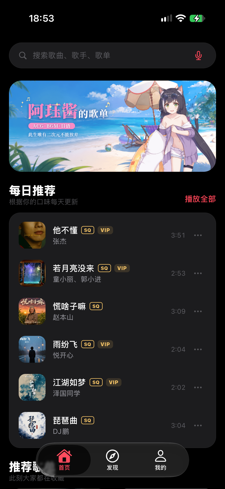
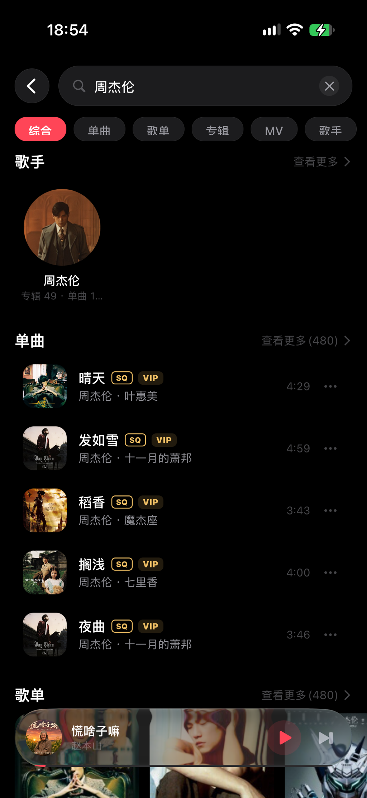

<div align="center">


# DL Music

一款开源、简洁、高颜值的第三方酷狗音乐移动端播放器

基于 Expo / React Native 构建，由 [MoeKoeMusic-Mobile](https://github.com/MoeKoeMusic/MoeKoeMusic-Mobile) fork 而来并深度改造

<a href="https://github.com/wdl821491110/DL-Music" target="blank"><strong>🌎 GitHub仓库</strong></a>&nbsp;&nbsp;|&nbsp;&nbsp;
<a href="https://github.com/wdl821491110/DL-Music/releases" target="blank"><strong>📦️ 下载安装包</strong></a>

[](https://expo.dev/)
[](https://reactnative.dev/)
[](https://www.typescriptlang.org/)
[](LICENSE)
[](#)

</div>

---

## 🙏 关于本项目

本项目 fork 自 [MoeKoeMusic-Mobile](https://github.com/MoeKoeMusic/MoeKoeMusic-Mobile)，在其基础上做了大量改造：音源兜底、会员取链修复、平板侧栏、下载音质选择、跨端适配等。

底层酷狗 API 适配层来自上游项目，特此感谢：

- [MoeKoeMusic-Mobile](https://github.com/MoeKoeMusic/MoeKoeMusic-Mobile) — 本项目的直接上游（移动端）
- [MoeKoeMusic](https://github.com/iAJue/MoeKoeMusic) — 桌面版（Windows / macOS / Linux）
- [KuGouMusicApi](https://github.com/MakcRe/KuGouMusicApi) — 酷狗音乐 Node.js API，数据源基础

## ✨ 特性

- 🎵 **无需自建服务器** — 酷狗 API 适配层直接直连官方，开箱即用，不依赖外部 API 地址
- 🛡️ **多音源兜底** — 首选源受限时自动切换备用音源，会员/版权歌也能兜底播放
- 🏠 **首页推荐** — 每日推荐、精选歌单、排行榜
- 🧭 **发现页** — 分类歌单、新歌速递等内容探索
- 🔍 **搜索** — 快速检索歌曲、歌单、专辑
- 📀 **歌单 / 专辑 / 排行榜** — 完整的详情页与曲目列表
- 🎧 **播放器** — 滚动歌词、播放队列、迷你播放条（MiniPlayer）、后台播放
- 🎚️ **音质选择与下载** — 播放/下载可选标准、高清、无损三档
- 📱 **手机号登录** — 同步酷狗账号的收藏与歌单
- 📐 **平板适配** — 平板/横屏侧栏分栏布局，手机布局不受影响
- 🌗 **深色模式** — 跟随系统自动切换明暗主题

## 📝 Todo List

- [x] 首页每日推荐 / 精选歌单 / 排行榜
- [x] 发现页分类内容浏览
- [x] 搜索歌曲、歌单、专辑
- [x] 歌单 / 专辑 / 排行榜详情页
- [x] 播放器：滚动歌词、播放队列、迷你播放条、后台播放
- [x] 音质检测与自动选择、下载音质选择
- [x] 手机号登录 / 账号密码登录 / 扫码登录
- [x] 我喜欢 / 收藏同步、用户歌单管理
- [x] 多音源兜底播放
- [x] 平板与横屏侧栏适配
- [ ] 通知栏 / 锁屏播放控制
- [ ] 桌面歌词
- [ ] 听歌识曲
- [ ] Windows 桌面版适配
- [ ] 性能优化

## 📸 预览

<table>
  <tr>
    <td></td>
    <td></td>
    <td></td>
  </tr>
  <tr>
    <td></td>
    <td></td>
    <td></td>
  </tr>
</table>

## 🚀 快速开始

### 环境要求

- [Node.js](https://nodejs.org/) ≥ 22
- [Git](https://git-scm.com/)
- iOS 模拟器 / Android 模拟器，或安装了开发版客户端的真机

### 开发运行

```bash
# 克隆仓库（包含 api submodule）
git clone --recurse-submodules https://github.com/wdl821491110/DL-Music.git
cd DL-Music

# 安装依赖
npm install
npm --prefix api install

# 生成移动端 API 入口（api/ 更新后需重新执行）
npm run generate:mobile-api

# 启动开发服务器
npx expo start
```

> 如果克隆时遗漏了 submodule，可执行 `git submodule update --init` 补齐。

### 打包构建

项目使用 GitHub Actions 自动构建，也可使用 [EAS Build](https://docs.expo.dev/build/introduction/)：

```bash
# 开发版（Development Client）
eas build --profile development --platform android

# 生产版
eas build --profile production --platform all
```

## 🏗️ 项目结构

```
├── api/                    # KuGouMusicApi（git submodule）
├── scripts/
│   └── generate-mobile-api-entry.mjs   # 扫描 api/module 生成移动端入口
├── src/
│   ├── app/                # expo-router 路由
│   │   ├── (tabs)/         # 首页、发现、我的（平板侧栏分栏）
│   │   ├── player.tsx      # 全屏播放页
│   │   ├── search.tsx      # 搜索页
│   │   ├── login.tsx       # 登录页
│   │   └── playlist|album|rank/[id].tsx  # 详情页
│   ├── components/ui/      # 通用 UI 组件（歌词、队列、迷你播放条、侧栏等）
│   ├── features/           # 业务模块（player / discover / search / account ...）
│   ├── lib/                # API 运行时适配层 / 备用音源 / 分享
│   ├── hooks/              # 通用 Hooks
│   └── constants/          # 主题与布局常量
├── app.json                # Expo 应用配置
└── eas.json                # EAS 构建配置
```

## 🔧 技术栈

| 类别 | 方案 |
| --- | --- |
| 框架 | [Expo SDK 57](https://expo.dev/) + [React Native 0.86](https://reactnative.dev/) + React 19（启用 React Compiler） |
| 路由 | [expo-router](https://docs.expo.dev/router/introduction/)（文件路由 + Typed Routes） |
| UI | [Tamagui v2](https://tamagui.dev/) |
| 音频 | [expo-audio](https://docs.expo.dev/versions/latest/sdk/audio/)（支持后台播放） |
| 动画 | react-native-reanimated 4 |
| 数据源 | [KuGouMusicApi](https://github.com/MakcRe/KuGouMusicApi)（应用内运行，无需部署） |

## 💬 贡献

欢迎任何形式的贡献！

1. Fork 本仓库
2. 创建特性分支：`git checkout -b feat/amazing-feature`
3. 提交更改：`git commit -m 'feat: add amazing feature'`
4. 推送分支并发起 Pull Request

发现问题或有功能建议，请提交 [Issue](https://github.com/wdl821491110/DL-Music/issues)。

## ⚠️ 免责声明

1. 本项目仅供**学习与技术研究**使用，请勿用于任何商业用途。
2. 本项目不存储、不分发任何音频资源，所有数据均来自酷狗音乐官方接口。
3. 音乐版权归酷狗音乐及相应版权方所有，请支持正版音乐。
4. 使用本项目产生的一切后果由使用者自行承担，与开发者无关。

## 📄 License

本项目基于 [GPL-2.0 License](LICENSE) 开源。
